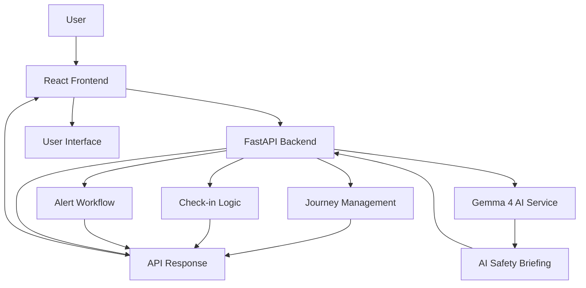

c# SafeWalk 🛡️
### AI-Powered Personal Safety & Journey Monitoring

<p align="center">
  <strong>Making personal safety more proactive, accessible, and manageable.</strong>
</p>

<p align="center">
  
  
  
  
  
</p>

---

## 📌 Overview

SafeWalk is an AI-powered personal safety web application designed to help users monitor their journeys, perform safety check-ins, and access contextual safety guidance.

The application combines journey monitoring and rule-based alert workflows with a generative AI component powered by Gemma 4.

SafeWalk aims to encourage proactive safety planning by allowing users to create a journey, provide trusted-contact information, and interact with safety features through a simple interface.

> **Project status:** Hackathon prototype. Alert delivery through real SMS messages or emergency phone calls is not currently connected. Alerts are simulated within the application.

---

## 🚨 The Problem

Travelling alone can create uncertainty for individuals and their families.

Common concerns include:

- Difficulty keeping trusted contacts informed during a journey.
- Forgetting to check in at an expected time.
- Limited access to practical, personalized safety guidance.
- Lack of a simple interface for managing journey safety.

SafeWalk explores how journey monitoring, check-in workflows, and AI-generated guidance can be combined into one application.

## 💡 Our Solution

SafeWalk provides a centralized interface for journey safety management.

Users can:

- Set up a journey.
- Provide trusted-contact information.
- Allow location access for journey monitoring.
- Perform safety check-ins.
- Trigger an SOS workflow.
- View journey and alert information.
- Receive AI-generated safety guidance through Gemma 4.

---

## ✨ Features

### 🗺️ Journey Setup and Monitoring
Create a journey by providing the required journey details and trusted-contact information.

### 📍 Location Access
Uses the browser's Geolocation API with user permission to obtain location coordinates.

### ✅ Safety Check-ins
Allows users to confirm that they are safe during an active journey.

### ⏱️ Missed Check-in Workflow
Uses time-based and rule-based application logic to handle missed check-ins.

### 🆘 SOS Workflow
Provides an SOS interaction that triggers the application's alert workflow.

### 🤖 AI Safety Briefing
Integrates Gemma 4 to generate contextual safety guidance based on information provided to the AI service.

### 📋 Journey and Alert Information
Displays journey status and relevant alert information through the application interface.

---

## 🧠 AI Integration — Gemma 4

SafeWalk integrates Gemma 4 as its generative AI component.

The AI service is responsible for generating safety guidance. It does not independently track users, control check-in timers, or send emergency calls.

### AI Workflow

1. The user provides journey information through the interface.
2. The React frontend sends a request to the FastAPI backend.
3. The backend prepares the prompt and sends it to the configured AI endpoint.
4. Gemma 4 generates a safety briefing.
5. The backend returns the response to the frontend.
6. The interface displays the generated guidance.

If AI generation is unavailable, the application can use its configured fallback safety guidance.

### Why Gemma 4?

Gemma 4 provides a generative AI capability that can produce natural-language safety guidance rather than relying exclusively on fixed text.

The model is used for AI-generated advice, while the application's backend manages journey and alert logic.

---

## 🛠️ Tech Stack

| Technology | Purpose |
|---|---|
| React | Frontend user interface |
| JavaScript | Frontend application logic |
| HTML5 | Application structure |
| CSS3 | Styling and responsive interface |
| Python | Backend programming language |
| FastAPI | Backend API framework |
| Gemma 4 | Generative AI safety guidance |
| HTTP / JSON | Frontend-backend communication |
| Browser Geolocation API | User-permitted location access |
| Uvicorn | ASGI server for running FastAPI |
| Git and GitHub | Version control and source-code hosting |

---

## ⚙️ System Architecture



### Architecture Components

**Frontend:**  
React manages the user interface and sends requests to the backend.

**Backend:**  
FastAPI processes API requests and manages journey-related application logic.

**AI Service:**  
The Gemma 4 integration generates safety guidance through the configured AI endpoint.

**Alert Workflow:**  
Application logic manages check-ins, missed check-ins, and simulated alert events.

---

## 🧮 Algorithms and Application Logic

SafeWalk combines conventional application logic with generative AI.

| Technique | Application |
|---|---|
| Rule-based state management | Manages journey states and application events |
| Conditional logic | Determines which workflow to trigger based on user actions |
| Time-based countdown logic | Handles check-in deadlines and missed-check-in events |
| Geolocation API | Obtains coordinates after permission is granted |
| LLM inference | Generates safety guidance using Gemma 4 |
| Fallback handling | Provides standard guidance when AI generation is unavailable |

The current prototype does not claim to use a trained emergency-prediction model or an automatic danger-detection algorithm.

---

## 🖥️ Getting Started

Follow these steps to run SafeWalk locally.

### Prerequisites

Install the following:

- Python 3.12
- Node.js and npm
- Git
- A compatible Gemma 4 inference provider, if you want to use the AI briefing feature

### 1. Clone the Repository

```bash
git clone https://github.com/LaibaImran786/SafeWalk.git
cd SafeWalk
```

### 2. Set Up the Python Environment

```powershell
python -m venv .venv
```

Activate the environment in Windows PowerShell:

```powershell
.\.venv\Scripts\Activate.ps1
```

Install backend dependencies:

```powershell
cd backend
python -m pip install -r requirements.txt
```

### 3. Configure Environment Variables

Create a `.env` file in the backend directory using `.env.example` as a reference.

Example:

```env
GEMMA_API_URL=http://localhost:11434/v1/chat/completions
GEMMA_MODEL=gemma4
GEMMA_API_KEY=your_api_key_here
```

Configure these values according to your AI provider.

**Never commit your actual `.env` file or API keys to GitHub.**

### 4. Start the Backend

From the project root:

```powershell
.\.venv\Scripts\python.exe -m uvicorn app:app --reload --app-dir backend
```

The backend will start using Uvicorn.

### 5. Start the Frontend

Open a separate terminal:

```powershell
cd frontend
npm install
npm run dev
```

Open the local URL displayed by Vite, typically:

```text
http://localhost:5173
```

---

## 🔐 Privacy and Safety

SafeWalk is a prototype intended to explore personal safety workflows.

- Location access requires browser permission.
- Users should avoid entering sensitive information into public demonstrations.
- AI-generated safety guidance may be inaccurate.
- The AI briefing is advisory and does not replace emergency services.
- The current alert workflow is simulated.
- Real SMS and emergency phone-call delivery are not connected.

SafeWalk does not guarantee personal safety or emergency response.

---

## 🚧 Current Limitations

- Real SMS delivery is not implemented.
- Real emergency phone calls are not implemented.
- AI guidance depends on the configured model endpoint being available.
- AI-generated advice may require verification.
- The application is currently a prototype rather than a production emergency-response system.

---

## 🔮 Future Improvements

Potential future development includes:

- Integration with a supported SMS provider.
- Real emergency-contact notification workflows.
- More robust journey-state synchronization.
- Improved location-history handling.
- Additional privacy and security controls.
- Enhanced accessibility.
- Testing and deployment as a production-ready application.

---

## 📸 Screenshots

Add screenshots of the actual application here.

Suggested screenshots:

| Screen | Screenshot |
|---|---|
| Journey Setup | `docs/screenshots/journey-setup.png` |
| Active Journey | `docs/screenshots/active-journey.png` |
| AI Safety Briefing | `docs/screenshots/ai-briefing.png` |
| SOS Workflow | `docs/screenshots/sos-workflow.png` |

To display a screenshot, use:

```markdown

```

---

## 👩‍💻 Author

**Laiba Imran**

Computer Science Student | AI and Full-Stack Development

GitHub: [@LaibaImran786](https://github.com/LaibaImran786)

---

## 📄 License

This project is licensed under the MIT License. See the [LICENSE](LICENSE) file for details.

---

<p align="center">
  <strong>SafeWalk — Helping people plan safer journeys.</strong>
</p>
